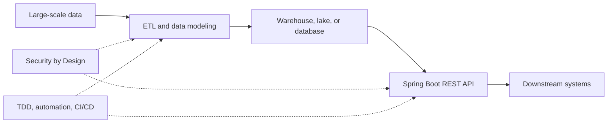

# Job #1: Senior Software Engineer, OF/OM Data Enablement

**Company:** John Deere (John Deere Financial)
**Recruitment ID:** 124049
**Posted:** 09/29/2026
**Source:** `Job Description Print Preview - SAP SuccessFactors.pdf` (downloaded 10/12/2026)

## Overview

| Field | Details |
|---|---|
| **Title** | Senior Software Engineer, OF/OM Data Enablement - 124049 |
| **Primary Location** | Chicago, Illinois, United States |
| **Work Model** | Onsite |
| **Organizational Group** | Enterprise Information Technology |
| **Personnel Area** | World Hq |
| **Function** | Technology (CA) |
| **Job Family** | Software Engineering |
| **GJE Job Title** | Senior Software Engineer - Software Engineering |
| **Job Grade** | 08 |
| **Exemption Status** | Exempt |
| **Hiring Manager** | Devendra Singh |
| **Employee Referral Bonus** | Not specified |
| **Salary Range** | $124,584.00 - $186,864.00 + Benefits |

> ⚠️ **VISA sponsorship is NOT available for this position.**

---

## About John Deere

John Deere's stated purpose is to "run so life can leap forward" by dreaming, designing, and delivering breakthrough products that sustain the world. The posting connects this purpose to feeding billions of people and building vital infrastructure, and describes the company's nearly two-century legacy from its founder's one-room blacksmith shop. It emphasizes a culture that brings out the best in people, where great ideas thrive because every voice is heard.

---

## Your Responsibilities

As a **Data Engineer** for **John Deere Financial** in **Chicago, IL**, you will:

- Develop data models and data pipelines, and build REST APIs to provide data to downstream systems
- Debug and fix application issues, perform root cause analysis, and help with proactive/preventive maintenance
- Perform code reviews and pair programming, and establish test automation processes
- Lead efforts to minimize technical debt
- Work as an Agile team member: backlog refinement, sprint planning, sprint review, and sprint retrospective
- Follow Security by Design principles to define the security framework around data pipelines and APIs
- Help onboard new team members

---

## Required Skills

- [ ] 4+ years of experience with **ETL, Data Modeling, Data Warehousing**, and working with large-scale datasets
- [ ] 4+ years of **API development** experience (specifically **REST APIs using Java, Spring Boot**)
- [ ] 2+ years of **Test-Driven Development (TDD)**
- [ ] 2+ years leveraging **DevOps** and lean development principles such as **continuous integration and continuous delivery/deployment (CI/CD)**, using tools like **Git and Jenkins**
- [ ] Working knowledge of **Data Engineering** tools and technologies (e.g., **Apache Spark, Databricks, Python, SQL DB, NoSQL DB, Data Lake** concepts)
- [ ] Working knowledge of **AWS** services such as **Lambda, RDS, ECS, DynamoDB, API Gateway, S3**, etc.
- [ ] Working knowledge of **Gen AI** and **Agentic patterns**
- [ ] Working knowledge of **Graph databases**

---

## What Makes You Stand Out

- AWS certification or working experience in AWS cloud or other cloud technologies
- Passionate, creative, with a desire to learn new complex technical areas
- Accountable, curious and collaborative, with an intense focus on product quality
- Skilled in interpersonal communication, able to explain complex topics to non-technical audiences
- Experience working in an Agile team environment
- Demonstrated ability to function in a fast-paced, collaborative team environment distributed across time zones and locations

---

## Education

Ideally a **Bachelor's or higher degree** in IT, Computer Science, Engineering, Data Science, or equivalent experience in a related career field.

---

## Competencies

Competencies for this posting can be found in the John Deere **Job Catalog Home** by searching for the GJE job title, **Senior Software Engineer - Software Engineering**.

---

## Additional Information

- Deere is interested in hiring talented people quickly. Requisitions stay posted until a qualified pool of candidates is identified, with no minimum posting period. Applicants are encouraged to apply promptly.
- Must be **18 years of age or older** to apply.
- Employee benefits are described in the *Employee Benefits Summary Plan Description* (link provided in the original posting).
- **Relocation:** If moving to an area where housing and general expenses are significantly higher, the company may provide a transitional benefit for a specified period as part of the relocation package. Eligibility is based on a calculation by Runzheimer International, using a comprehensive assessment of living cost variables and individual characteristics.
- The posting is not an exhaustive list of responsibilities and qualifications. Its qualifications are guidelines, not minimum requirements. John Deere is an equal opportunity employer, including disabled persons and veterans.

---

## Key Tech Stack Summary

| Area | Technologies |
|---|---|
| **Languages** | Java, Python, SQL |
| **Frameworks** | Spring Boot (REST APIs) |
| **Data** | ETL, Data Modeling, Data Warehousing, Apache Spark, Databricks, SQL DB, NoSQL DB, Data Lake, Graph DB |
| **Cloud (AWS)** | Lambda, RDS, ECS, DynamoDB, API Gateway, S3 |
| **DevOps** | Git, Jenkins, CI/CD |
| **Practices** | TDD, Agile/Scrum, pair programming, code reviews, Security by Design |
| **Emerging** | Gen AI, Agentic patterns |

---

## Interview Prep Notes

_Add notes, questions, and application status here._

- **Application status:** _Not yet applied_
- **Date applied:** _TBD_
- **Contacts:** Hiring Manager: Devendra Singh

## Role Flow

This is a study map of the skills named in the posting, not a prescribed system design.

