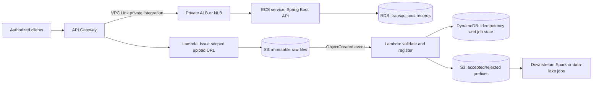

# AWS: Event-Driven Data API

**Type:** Supplemental original system-design exercise
**Sources:** [AWS Lambda with S3](https://docs.aws.amazon.com/lambda/latest/dg/with-s3.html) · [API Gateway proxy integration](https://docs.aws.amazon.com/apigateway/latest/developerguide/set-up-lambda-proxy-integrations.html) · [ECS](https://docs.aws.amazon.com/AmazonECS/latest/developerguide/Welcome.html) · [RDS](https://docs.aws.amazon.com/AmazonRDS/latest/UserGuide/Welcome.html) · [DynamoDB](https://docs.aws.amazon.com/amazondynamodb/latest/developerguide/bp-modeling-nosql.html)
**Focus:** AWS service selection, APIs, event-driven ETL, reliability, Security by Design

## Exercise

Design a system where authorized business users query and update operational records through REST APIs, while large source files are ingested asynchronously for downstream data processing. Use API Gateway, ECS, RDS, S3, Lambda, and DynamoDB where appropriate. Explain how to avoid duplicate processing and protect data.

Example scenario: customer `C7` requests an upload URL for `payments-20261012.csv`, then uploads it to S3. S3 emits the same `ObjectCreated` notification twice. The design should retain one raw file, create one idempotent ingestion job, route the file to an accepted or rejected prefix, and let `GET /v1/ingestions/{jobId}` return its status. A separate `GET /v1/accounts/{accountId}` API reads transactional account data.

Expected design checks: the upload API returns a scoped URL and object key; duplicate notifications do not create duplicate jobs or side effects; ingestion is asynchronous; RDS is not publicly reachable; unauthorized callers cannot read another customer's account or ingestion status; and the ECS API and ingestion Lambda have distinct least-privilege roles.

## Solution

- **API Gateway** authenticates/authorizes callers, applies request limits, and exposes versioned REST routes.
- **ECS** runs the long-lived Spring Boot API where connection pooling, steady traffic, and multiple endpoints justify a service. Keep tasks stateless and scale from observed load.
- **RDS** stores relational records requiring transactions, constraints, joins, and established SQL reporting. Put it in private subnets; use Multi-AZ when availability requirements justify the cost.
- **S3** stores raw files durably. Use separate prefixes or buckets for raw, accepted, and rejected objects; enable encryption, lifecycle policy, and access logging as required.
- **Lambda** handles short event-driven tasks: issue narrowly scoped upload authorization, validate S3 event records, and route accepted or rejected files. Configure the bucket trigger only for the incoming prefix to prevent recursive invocations.
- **DynamoDB** stores a small ingestion ledger keyed by a stable object/event identity. Use a conditional write to claim work once; retries see the existing state and do not repeat side effects.

**Reliability and security:** S3 notifications and Lambda processing can be retried, so make handlers idempotent, validate every event, use bounded retries/DLQs, and log correlation IDs. Give each execution role only the bucket/table actions it needs. Keep RDS private, retrieve credentials from a managed secret store, encrypt data in transit and at rest, validate API input, and publish CloudWatch metrics/alarms. Avoid putting secrets or full sensitive records in logs.

**Trade-off:** API Gateway can integrate directly with Lambda for short, spiky operations. Do not route a long-running data transformation through a synchronous API request; persist job state and return an accepted job identifier instead.
